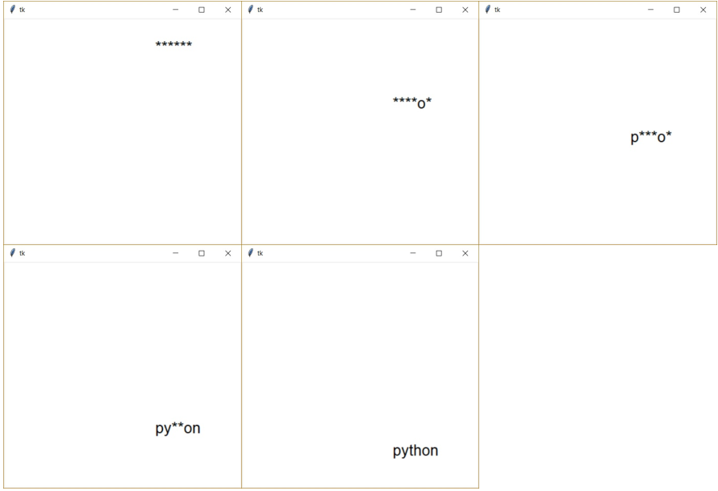

#  (44) Uhádni padající slovo

> `"", Cnv, fx(), aft.`


Vytvořte program, který umožní uživateli hrát hru "Uhodni padající slovo". Program má následující vlastnosti:

- Na obrazovce postupně z horního okraje a náhodné x-ové souřadnice padá náhodné slovo, přičemž znaky původního slova jsou nahrazeny hvězdičkami. Seznam slov, ze kterých se jedno náhodně vybere, je definován v úvodu programu.
- Hráč musí uhodnout slovo mačkáním kláves. Stiskne-li klávesa s písmenem, které se v hádaném slově nachází, všechny výskyty tohoto písmene se zobrazí namísto hvězdiček a na obrazovce dále padá částečně uhodnuté slovo.
- Pokud hráč nestihne uhodnout celé slovo, než spadne na spodní okraj, hra končí s vypsaným textem "Neuhádl jsi!".
- Pokud hráč uhodne celé slovo, hra se zastaví v aktuální pozici a vidíme celé (uhodnuté) slovo.

Příklad definice slov:

```python
slova = ('analyza', 'python', 'ukol', 'reseni', 'vstup', 'vystup')
```


Ukázka obrazovek animace programu:




