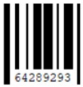
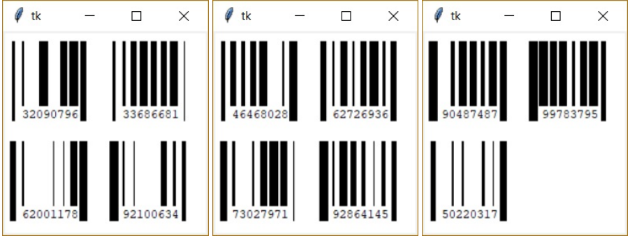

#  (47) Čárový kód

> `"", txt, Cnv, fx()`

Náš čárový kód obsahuje osmimístná čísla, která nezačínají nulou. Každá číslice je znázorněna čarou, jejíž tloušťka je rovna hodnotě číslice (např. číslice 4 bude zobrazena čarou o tloušťce 4). Čáry jsou dlouhé 80 bodů a jsou od sebe stejně vzdálené (prostor pro každou čáru má šířku 10 pixelů). Mezi první a poslední čarou je zobrazen i číselný kód, tedy druhá až sedmá čára nezasahují do číselného kódu. K úloze můžete využít připravené textové soubory `kod_1.txt`, `kod_2.txt` a `kod_3.txt`.

Ukázka grafického zobrazení našeho čárového kódu:




Vytvořte program, který bude pracovat s čárovým kódem následovně:

- vygeneruje náhodný kód a vypíše jeho číselnou hodnotu do shellu,
- graficky zobrazí čárový kód (dle ukázky),
- z textového souboru přečte čárový kód a vykreslí jej na obrazovku,
- postupně přečte všechny čárové kódy a zobrazuje je na obrazovce po čtveřicích (viz ukázku), stisknutím mezery se zobrazí další čtveřice.

Ukázka vstupního textového souboru:

```
13419824
21603459
38546595
14290739
32649199
```

Ukázka zobrazování čárového kódu po čtveřicích z textového souboru:



