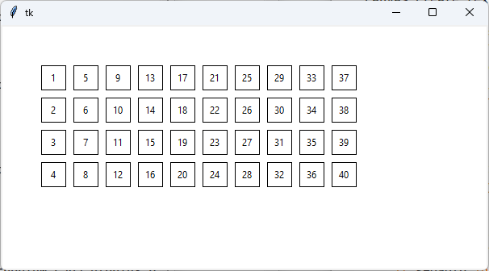
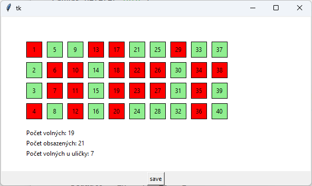

# (49) Rezervace místenek v autobuse

> `"", [], txt, Cnv, fx()`

Níže v tomto zadání je připraven program, který vykreslí plán autobusu, reaguje na kliknutí myší nad místem v plánu a vypíše číslo sedadla, na které jsme klikli. Program vykreslí například takový plán (při nastavení 10 řad sedadel `pocet_rad = 10`):




Připravený program:

```python
import tkinter
canvas = tkinter.Canvas(width=600, height=300, bg='white')
canvas.pack()

pocet_rad = 10
VEL = 40
busx, busy = 50, 50

def obarvi(sedadlo, barva):
    canvas.itemconfig('sedadlo_' + str(sedadlo), fill=barva)
    
def kresli(x, y, pocet):
    cislo = 0
    for i in range(pocet):
        for j in range(4):
            cislo += 1
            canvas.create_rectangle(x+i*VEL, y+j*VEL,
                                    x+(i+1)*VEL-10, y+(j+1)*VEL-10,
                                    tags='sedadlo_'+str(cislo))
            canvas.create_text(x+i*VEL+VEL/2-5, y+j*VEL+VEL/2-5, text=cislo)

def klik(event):
    if (busx < event.x < busx + VEL * pocet_rad and
        busy < event.y < busy + VEL * 4):
        ix = (event.x - busx) // VEL
        iy = (event.y - busy) // VEL
        sedadlo = ix * 4 + iy + 1
        obarvi(sedadlo, 'red')
        print(sedadlo)

kresli(busx, busy, pocet_rad)
canvas.bind('<Button-1>', klik)
```

Upravte program na rezervaci místenek, aby měl následující vlastnosti:

- Na začátku jsou všechna sedadla volná, zabarví se světle zelenou barvou.
- Klepnutím na sedadlo sedadlo obsadíme nebo uvolníme podle toho, zda je volné nebo obsazené. Obsazená sedadla jsou červená.
- Program průběžně pod plánem zobrazuje aktuální stav obsazenosti - vypisuje počet volných sedadel, počet obsazených sedadel a počet volných sedadel při uličce (vnitřní dva řádky).
- V programu je tlačítko **save**. Tlačítkem uložíme plán autobusu do textového souboru tak, aby vizuálně obsah souboru připomínal grafickou podobu plánu (viz ukázka). Volná sedadla jsou uložena jako čísla (číslo
sedadla) a na místě obsazených sedadel je písmeno `X`.

Ukázka plánu s obsazenými a volnými sedadly:



Ukázka textového souboru pro plán na předchozím obrázku:

```
 X  5  9  X  X 21 25  X 33 37
 2  X  X 14  X  X  X 30  X  X
 3  X  X 15  X  X  X 31  X 39
 X  8  X 16  X 24 28 32  X 40
```

Otázky:

1. Jak bychom četli takový textový soubor?
2. Lze ze zapsaného textového souboru zjistit počet řad, nebo potřebujeme ukládat i tuto informaci?


