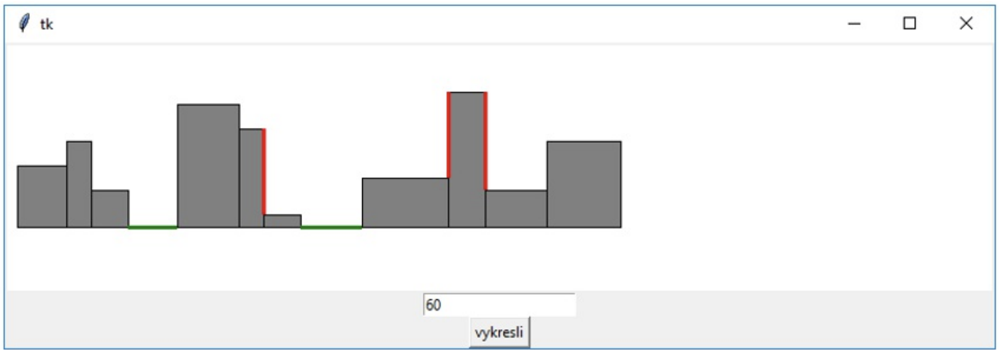

# (53) Zástavba na ulici

> `[], txt, Cnv`

Institut pro rozvoj městské architektury potřebuje jednoduchý simulátor městské zástavby na ulici kvůli regulování výšky budoucích novostaveb.

Vytvořte program, který ze souboru `zastavba_na_ulici.txt` načte informace o výškách a šířkách (v metrech) budov na ulici. Na každém řádku vstupního souboru jsou pouze dvě celá čísla – výška a šířka budov odděleny mezerou. Program bude mít tyto vlastnosti:

- Zobrazí budovy vykreslené vedle sebe jako obdélníky (viz ukázka).
- V případě, že je na ulici volné místo (s nulovou výškou) vyznačí se silnější zelenou vodorovnou čarou. To je totiž potenciální místo pro novou výstavbu.
- Zvýrazní na rozhraní budov červenou svislou čarou příliš velké stěny, tedy místa, kde je výškový rozdíl mezi dvěma stávajícími sousedními budovami příliš velký – tato kritická hranice v metrech se zadá pomocí vstupního pole Entry. Tato vlastnost pomůže městským architektům eliminovat zubaté ulice s výraznými bočními stěnami objektů.

Ukázka vstupního souboru:

```
40 50
20 70
30 30
40 0
50 100
```

Ukázka výstupu programu:

 

**Poznámka:** Stěna čtvrté budovy zleva na obrázku není zvýrazněna červenou barvou, neboť vedle ní nestojí žádná budova.

