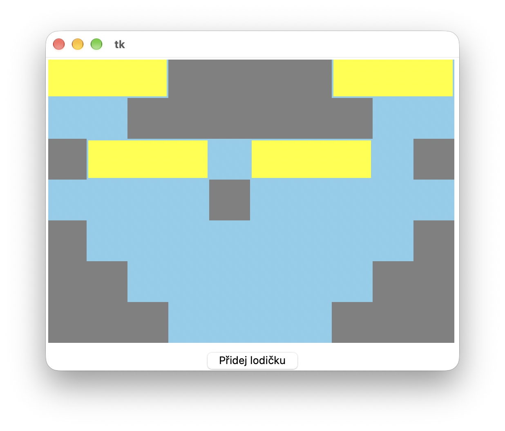
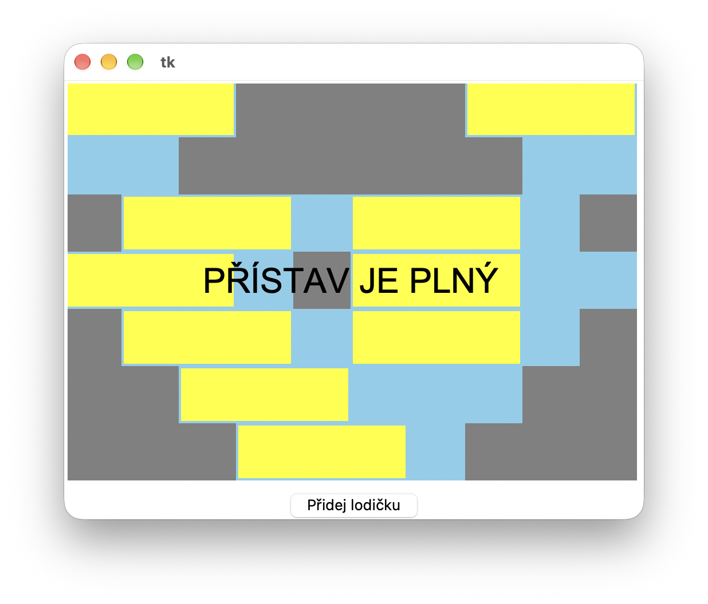

# (54) Kotviště lodiček

> `[[]], txt, Cnv, fx()`


Naprogramujte simulátor lodiček zakotvených v zátoce. V textovém souboru `lodicky.txt` je uložen popis zátoky – dvourozměrná mapa znaků `0` a `1` oddělených mezerou. Znak `1` znamená pevninu a `0` znamená vodu. Na prvním řádku jsou rozměry (šířka a výška) této mapy – dvě celá čísla oddělená mezerou. Zátoka se tedy může vyjádřit jako dvourozměrná mapa čtverečků pevnina/voda. Program po kliknutí na tlačítko vygeneruje jednu lodičku někam do vody v zátoce. Dalším klikáním na tlačítko generuje další lodičky, dokud se zátoka nezaplní.

Pravidla generování resp. umísťování lodiček:

- Lodička je trojice sousedících čtverečků v řádku.
- Dvě lodičky v jednom řádku se nesmí dotýkat – musí být mezi nimi alespoň jedno políčko vody.
- Lodičky v řádcích pod sebou se dotýkat mohou (na vedlejší řádek se tedy nebere ohled).
- Lodička se může dotýkat pevniny.

Vytvořte program, který bude mít tyto vlastnosti:

- Vykreslí zátoku ze čtverečků podle mapy ze souboru.
- Po kliknutí na tlačítko vykreslí jednu lodičku. Lodička může být vygenerována na náhodnou pozici nebo s nějakou strategií (např. od vrchu mapy).
- Vypíše na obrazovku hlášení, že zátoka je plná, pokud se již do přístavu v zátoce nevejde žádná další lodička.

Ukázka vstupního souboru:

```
10 7
0 0 0 1 1 1 1 0 0 0
0 0 1 1 1 1 1 1 0 0
1 0 0 0 0 0 0 0 0 1
0 0 0 0 1 0 0 0 0 0
1 0 0 0 0 0 0 0 0 1
1 1 0 0 0 0 0 0 1 1
1 1 1 0 0 0 0 1 1 1
```

Ukázka programu – přístav se čtyřmi umístěnými žlutými lodičkami a ukázka plného přístavu (pro vstupní soubor v ukázce):





