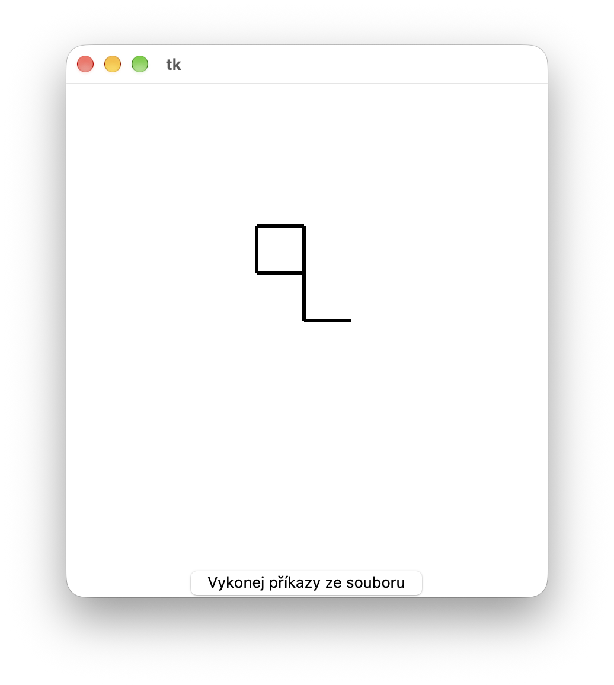

#  (55) Kreslící robot 2

> `"", [], txt, Cnv, fx()`

Kreslící robot poslouchá zadané příkazy a podle nich kreslí obrázky. Robot má svou pozici a směr, kterým je natočen (pouze nahoru/dolů/vpravo/vlevo).

Robot zná následující příkazy:

- `cara` – nakreslí směrem, kterým je natočen čáru délky 50 pixelů a přesune se na konec této čáry,
- `vlevo` – otočí se o 90 stupňů vlevo (bez jakéhokoli kreslení),
- `vpravo` – otočí se o 90 stupňů vpravo (bez jakéhokoli kreslení),
- Příkaz cyklu: Příkazy mezi řádky `opakuj` a `konecopakuj` se provádějí opakovaně. Počet opakování udává číslo za slovem `opakuj`. Ukázka zápisu:

```
opakuj 4
cara
vpravo
...
konecopakuj
```

Vytvořte program, který bude simulovat činnost kreslícího robota. Na začátku programu je robot umístěn ve středu grafické plochy a je natočen směrem nahoru. Program samotného robota nezobrazuje. Po klepnutí na tlačítko **Kresli** robot provede příkazy, které jsou pro něj uloženy v souboru `robot2.txt`. Robot tedy vykreslí obrázek podle příkazů ze souboru. Vlastnosti vytvořeného programu:

- Robot zvládá provádění příkazu `cara` z textového souboru. Kreslí tedy čáru směrem nahoru.
- Robot zvládá také provádění příkazů `vpravo` a `vlevo` z textového souboru. Další čáry se tak již vykreslují daným směrem.
- Robot zvládá také provádění cyklu `opakuj... konecopakuj`.

Ukázka vstupního souboru:

```
cara
opakuj 4
cara
vlevo
konecopakuj
vpravo
vpravo
cara
vlevo
cara
```

Ukázka výstupu programu po provedení příkazů ve vstupním souboru:



