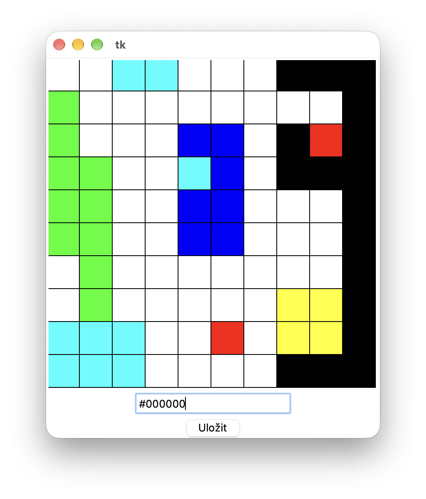

# (56) Editor levelů 1

> `[], txt, Cnv, fx()`

Tvůrci her dodávají ke svým hrám také editory levelů hry, díky kterým si hráči mohou nadesignovat do hry vlastní mapu levelu. Vytvořte program - editor, který bude mít tyto vlastnosti:

- Zobrazí prázdnou čtvercovou síť velikosti 10&times;10 čtverečků.
- Umožní uživateli klikáním myší zabarvovat jednotlivá políčka mřížky. Uživatel tak umisťuje do plochy levelu překážky, resp. stěny a podobně.
- Uživatel si může nastavit barvu překážky pomocí komponenty Entry zadáním kódu barvy v hexadecimálním zápisu. Každé další kliknutí tak zabarvuje políčka právě zadanou barvou.
- Klepnutím na tlačítko **Uložit** se mapa uloží do textového souboru `level_vystup.txt`. Způsob uložení informací o překážkách si zvolte sami. Podstatné je, aby v souboru byly uloženy všechny potřebné údaje pro načtení a vykreslení mapy s překážkami daných barev. Samotné načtení a vykreslení mapy ze souboru v tomto zadání programovat nemusíte.

Ukázka obrazovky programu:

 

