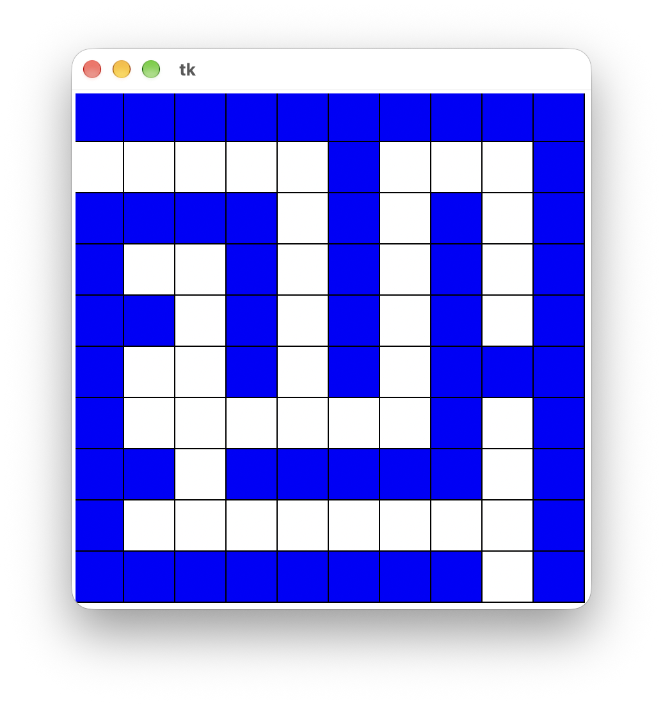

# (57) Editor levelů 2

> `[], Cnv, fx()`

Tvůrci her dodávají ke svým hrám také editory levelů hry, díky kterým si hráči mohou nadesignovat do hry vlastní mapu levelu. Vytvořte program - editor, který bude mít tyto vlastnosti:

- Zobrazí prázdnou čtvercovou síť velikosti 10&times;10 čtverečků.
- Umožní uživateli klikáním myší přidávat stěny do bludiště - prvním kliknutím se označí začátek nové stěny (zabarví se políčko, do kterého se kliklo).
- Druhým kliknutím se označí konec rovné stěny a vykreslí se celá stěna (zabarví se všechna políčka mezi začátečním a koncovým). Stěna však může být pouze rovná, tedy vykreslí se, pouze pokud koncové políčko bylo zvoleno ve stejném řádku nebo sloupci jako počáteční. Pokud při druhém kliknutí bylo koncové políčko zvoleno šikmo, počáteční políčko stěny se odznačí.
- Každé další kliknutí označí začátek nové stěny a následné kliknutí stěnu vykreslí podle výše uvedených pravidel.

Ukázka obrazovky programu:

