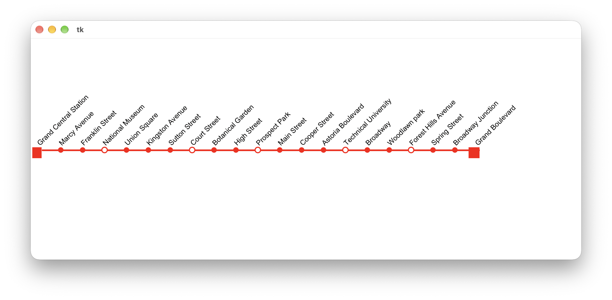

#  (58) Trasa linky metra

> `"", [], txt, Cnv`

Ve vozech soupravy metra je vždy nad dveřmi nalepeno schéma dané konkrétní linky metra. Jedná se o vodorovnou čáru barvy, jakou má daná linka, na které jsou vyznačeny zastávky (viz ukázka). Podnik provozující síť metra má údaje o jednotlivých trasách linek uložené v souborech. Program umí z těchto údajů vygenerovat nové schéma vždy, když nastanou nějaké změny, například když se otevře nová stanice.

Vytvořte program, který bude mít tyto vlastnosti:

- Načte ze souboru `trasa_linky_metra.txt` barvu linky (na prvním řádku souboru) a seznam stanic (na každém dalším řádku je právě jeden název) a zobrazí linku jako vodorovnou čáru s názvy stanic
v pravidelné vzdálenosti. Názvy stanic budou zobrazeny šikmo nad čarou.
- Zobrazí konečné stanice čtvercem na začátku a konci čáry.
- Na čáře zobrazí značky stanic – malé kroužky. Na těch přestupních stanicích nebudou kroužky vyplněny. Tyto stanice mají ve vstupním souboru těsně před názvem stanice zapsaný znak `*`.

Ukázka vstupního souboru:

```
#FF0000
Grand Central Station
Marcy Avenue
Franklin Street
*National Museum
Union Square
Kingston Avenue
Sutton Street
*Court Street
Botanical Garden
...
```

Ukázka grafického výstupu programu:



