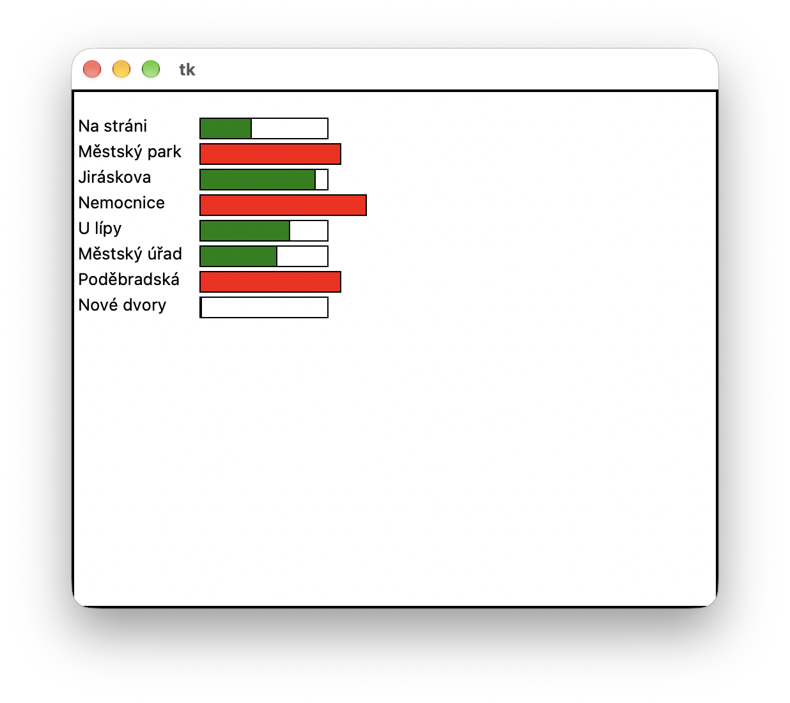

#  (59) Vytíženost autobusové linky

> `"", [], txt, Cnv, fx()`

Městský dopravní podnik se rozhodl provést průzkum vytíženosti svých autobusových linek. Pomocí automatických sčítacích zařízení vznikl soubor `vytizenost_linky.txt`, který má následující tvar:

```
50
20 0 Na stráni
35 0 Městský park
10 20 Jiráskova
40 20 Nemocnice
10 40 U lípy
5 10 Městský úřad
35 10 Poděbradská
0 55 Nové dvory
```

Vytvořte program, který vizualizuje stav naplněnosti autobusu:

- Vypíše do grafické plochy pod sebe názvy zastávek načtené ze souboru (název zastávky je dvouslovný nebo jednoslovný).
- Po stisku libovolné klávesy se vedle první zastávky zobrazí indikátor naplněnosti - obdélník částečně vyplněný zeleným pruhem. Prázdný obdélník znázorňuje sto procent kapacity autobusu a zelený pruh znázorňuje, kolik procent kapacity autobusu bylo po odchodu z první zastávky naplněno.
- Po každém dalším stisknutí libovolné klávesy se vedle následující zastávky zobrazí indikátor naplněnosti.
- Pokud nastane stav, že po odjezdu ze zastávky je autobus přeplněn (počet cestujících převyšuje povolenou kapacitu), tak indikátor přesáhne ohraničující obdélník a zobrazí se červenou barvou.

Ukázka grafického výstupu programu:



Otázka:

- Co byste museli změnit ve svém programu (vzhledem k možným víceslovným názvům zastávek), pokud by vstupní údaje na každém řádku byly odděleny středníkem?
