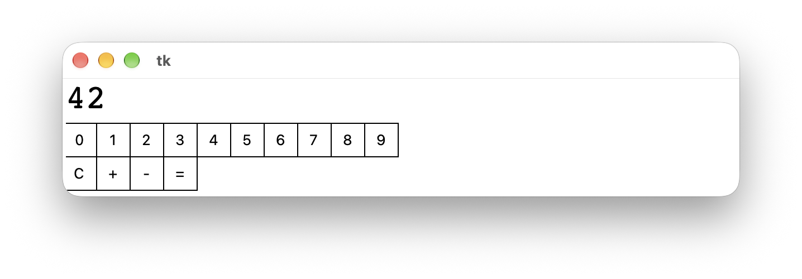

#  (60) Kalkulačka 

> `"", Cnv, fx()`

Vytvořte jednoduchou kalkulačku, která bude umět sčítat a odčítat. Tlačítka kalkulačky budou představovat čtverečky s textem vykreslené v grafické ploše.

Program bude mít tyto vlastnosti:

- Zobrazí čtvercová tlačítka s číslicemi vedle sebe. Nad nimi zobrazí displej s právě zadávaným číslem.
- Na začátku programu bude na displeji zobrazena nula.
- Po kliknutí na tlačítko s číslicí se daná číslice přidá k číslu na displeji, resp. pokud je na displeji nula, tak se zobrazí místo ní.
- Zobrazí v druhé řadě čtvercová tlačítka `+`, `-`, `=` a `C`.
- Po kliknutí na tlačítka `+` nebo `-` se na displeji opět zobrazí nula, abychom mohli zadávat druhé číslo pro sčítání / odčítání. Po klepnutí na tlačítko `=` se na displeji zobrazí výsledek operace.
- Po kliknutí na tlačítko `C` (Clear) se na displeji opět zobrazí nula a uživatel může zadávat nový příklad.

Ukázka obrazovky programu:

