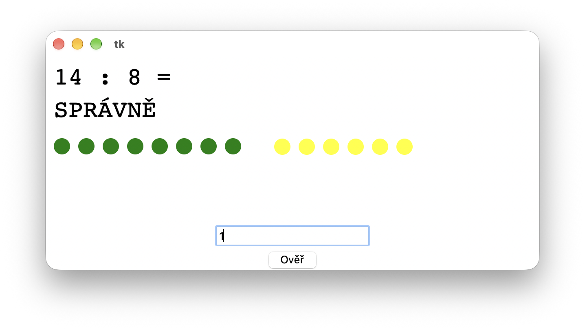
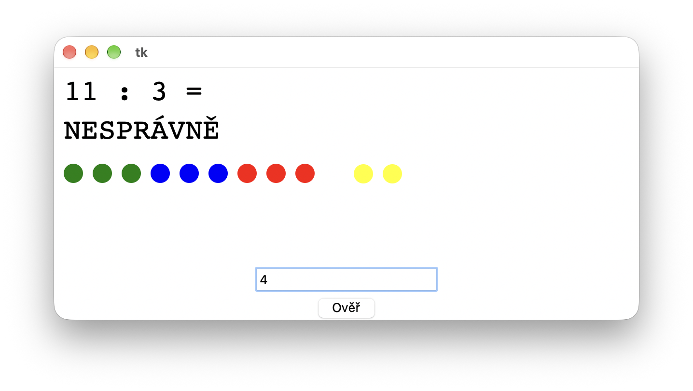

#  (61) Dělení

> `"", (), Cnv, fx()`

Vytvořte výukový program pro procvičování jednoduchých příkladů pro dělení celých čísel se zbytkem.

Program bude mít tyto vlastnosti:

- Vygeneruje příklad a zobrazí jej do grafické plochy. Dělenec je v rozsahu 11 až 20, dělitel od 2 do 9.
- Umožní uživateli zadat výsledek celočíselného dělení (zbytek nezadáváme) pomocí komponenty Entry. Po klepnutí na tlačítko Over program vypíše, zda je výsledek správný nebo nesprávný.
- Program názorně ukáže princip dělení - zobrazí dělence v podobě kroužků a vyznačí n-tice kroužků v počtu rovném děliteli, vždy jinou barvou (vybírejte barvy například z vámi připraveného seznamu).
- Kroužky odpovídající zbytku budou odděleny od ostatních.

Ukázka programu:

