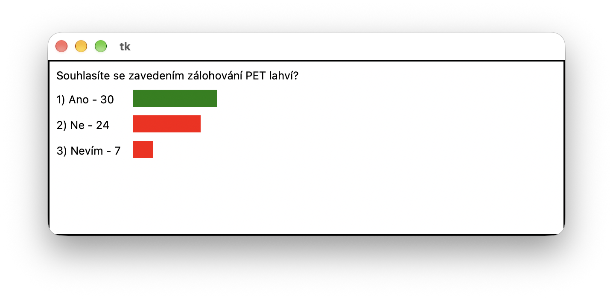
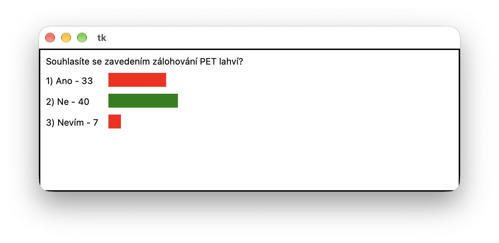

#  (62) Anketa

> `"", [], txt, Cnv, fx()`

Společnost ANKET s. r. o. zpracovává ankety, ve kterých zjišťuje názory veřejnosti na různá aktuální společenská témata. V textovém souboru `anketa.txt` se v prvním řádku nachází otázka a v dalším jsou uvedena tři čísla udávající počet dosavadních hlasů za možnosti Ano, Ne a Nevím, oddělené mezerou.

Ukázka textového souboru:

```
Souhlasíte se zavedením zálohování PET lahví?
30 24 7
```

Vytvořte program, který bude mít tyto vlastnosti:

- Vypíše otázku a pod sebe odpovědi a počty lidí, kteří hlasovali pro jednotlivé možnosti.
- Vedle hlasů zobrazí proužky, které graficky znázorňují procentuální zastoupení hlasů za jednotlivé odpovědi a zobrazí také, kolik lidí hlasovalo pro danou možnost.
- Proužek možnosti, pro kterou hlasovalo nejvíce lidí, bude zobrazen odlišnou barvou.
- Program umožní uživateli hlasovat: po stisku čísla odpovědi (`1`, `2` nebo `3`) se přičte hlas, aktualizuje se grafické zobrazení a program aktualizuje i soubor `anketa.txt`.

Ukázka obrazovky programu:



Ukázka obrazovky programu a obsah souboru `anketa.txt` po aktualizaci odpovědí:




```
Souhlasíte se zavedením zálohování PET lahví?
33 40 7
```


