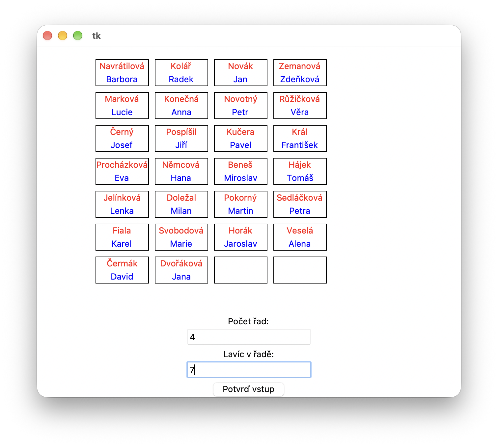
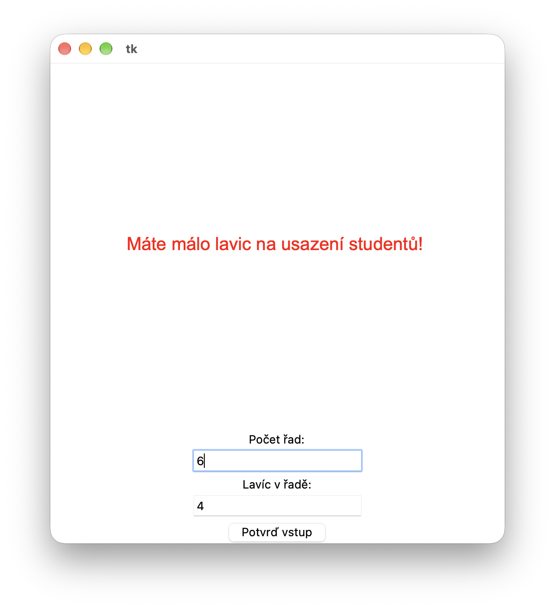

#  (64) Zasedací pořádek

> `"", (), [], txt, Cnv, fx()`


V textovém souboru `studenti.csv` je abecedně seřazen seznam studentů třídy. Na každém řádku je jméno jednoho studenta ve tvaru `příjmení;jméno`. Ukázka textového souboru:

```
Beneš;Miroslav
Čermák;David
Černý;Josef
Doležal;Milan
Dvořáková;Jana
Fiala;Karel
...
```

Vytvořte program, který ze seznamu studentů vytvoří náhodný zasedací pořádek. Program bude mít tyto vlastnosti:


- Pomocí dvou vstupních polí Entry programu zadáváme počet řad a počet lavic v jedné řadě. U vstupních polí je i popis polí. Vstup potvrdíme stisknutím tlačítka **Potvrď vstup**.
- Program z textového souboru přečte a zapamatuje si všechny studenty. Pokud uživatel zadal nedostatečný počet lavic pro všechny studenty, program nás na to upozorní vypsáním textu.
- Pokud se všichni studenti vejdou do lavic, program vykreslí zadaný počet lavic a do nich v náhodném pořadí umístí studenty. V lavici je jako první napsáno příjmení červenou barvou a pod ním křestní jméno modrou barvou.
- Pokud je studentů méně než počet lavic, zůstane příslušný počet lavic volný. Program usazuje studenty postupně od lavic vpředu. Volné zůstanou zadní lavice (viz ukázka).
- Tlačítkem **Potvrď vstup** můžeme zasedací pořádek vykreslit znovu nebo změnit jeho rozložení.

Ukázka obrazovky programu:




